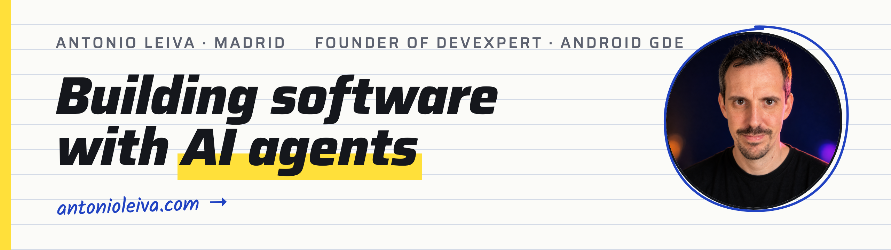
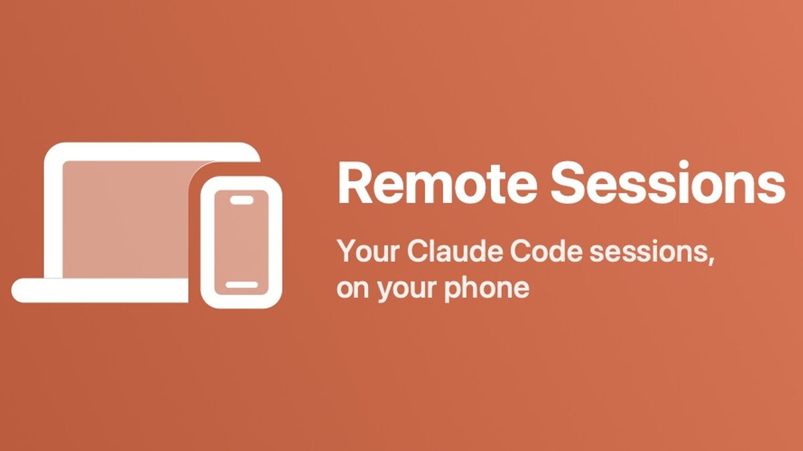
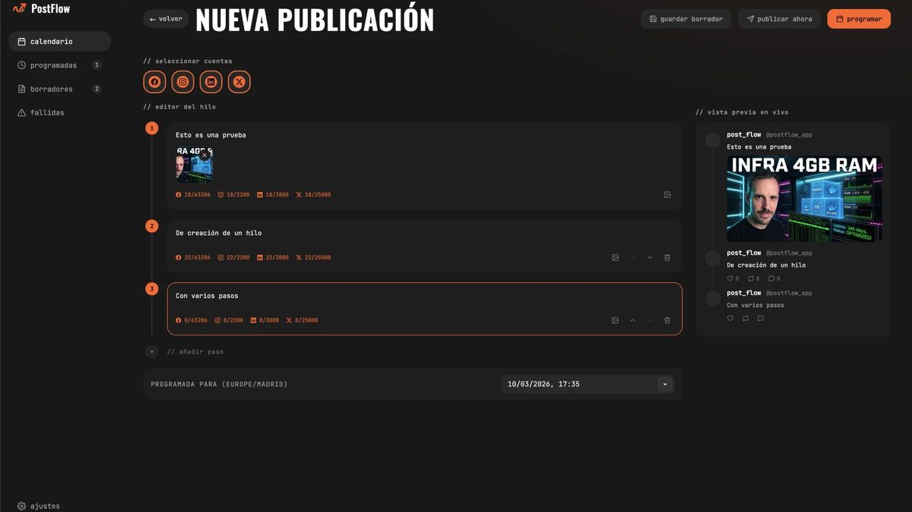
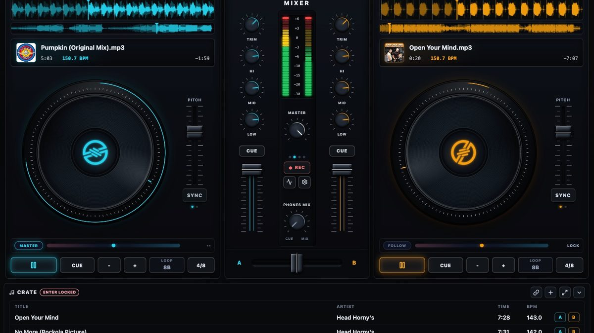
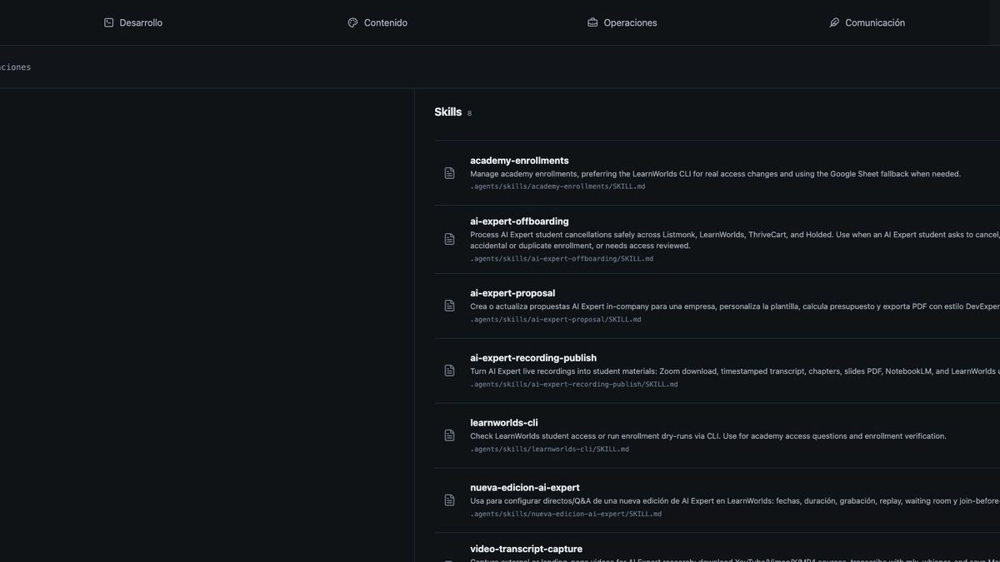
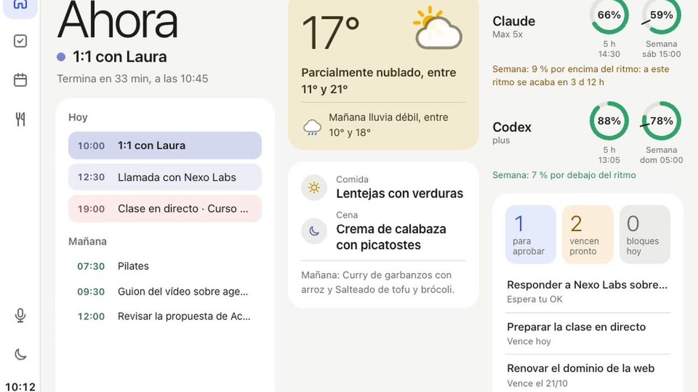
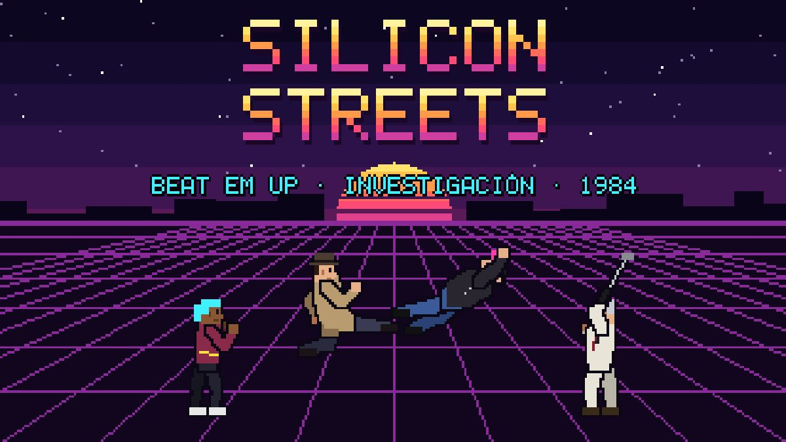

<a href="https://antonioleiva.com/en">
  <picture>
    <source media="(prefers-color-scheme: dark)" srcset="assets/header-dark.png">
    
  </picture>
</a>

I build software with AI agents and teach other developers to do the same. Founder of [DevExpert](https://devexpert.io), Google Developer Expert for Android, based in Madrid. On **[antonioleiva.com](https://antonioleiva.com/en)** every project has its own page: what it is, which agents I built it with and what I learned.

<!-- youtube-subs:start -->

<!-- youtube-subs:end -->

<!-- now:start -->
🛠️ Last commit (2026-11-06) in **[devdays-agenda-mcp](https://github.com/antoniolg/devdays-agenda-mcp)**: `Slides actualizadas: QR al repo en la slide de preguntas`
<!-- now:end -->

## What I'm building

<table>
  <tr>
    <td width="50%" valign="top">
      
      <b><a href="https://github.com/antoniolg/remote-sessions">remote-sessions</a></b> 
      An iOS and Android app that lists your Claude Code conversations and resumes any of them from your phone.
    </td>
    <td width="50%" valign="top">
      
      <b><a href="https://github.com/antoniolg/postflow">postflow</a></b> 
      Self-hosted social media publishing. Web UI, HTTP API, MCP endpoint and CLI in a single service.
    </td>
  </tr>
  <tr>
    <td width="50%" valign="top">
      
      <b><a href="https://github.com/antoniolg/next-dj">next-dj</a></b> 
      An open-source desktop DJ console. Two decks, waveforms, EQ, filters and session recording.
    </td>
    <td width="50%" valign="top">
      
      <b><a href="https://github.com/antoniolg/development-agent-dashboard">development-agent-dashboard</a></b> 
      A local panel to see and edit the AGENTS.md and skills of each Codex project.
    </td>
  </tr>
</table>

**Not public yet**, but each one has its page:

<table>
  <tr>
    <td width="33%" valign="top"> <b>tablero</b>: my day on a wall tablet</td>
    <td width="33%" valign="top"> <b>g-rally</b>: a gravel rally game</td>
    <td width="33%" valign="top"> <b>silicon-streets</b>: a 1984 beat 'em up</td>
  </tr>
</table>

And [a proactive personal agent](https://antonioleiva.com/en/projects/aibot) that runs on my own server. All of them are on [my projects page](https://antonioleiva.com/en/projects).

## Tools I use every day

- 🧩 **[agent-kit](https://github.com/antoniolg/agent-kit)**: My catalogue of skills for agents. Email, invoices, YouTube publishing, Slack, WhatsApp and a few more.
- 🛠️ **[harness-starter](https://github.com/devexpert-io/harness-starter)**: Four skills to go from an idea to your first verified feature with Claude Code, Codex or OpenCode.
- 📨 **[listmonk-cli](https://github.com/antoniolg/listmonk-cli)**: Manage Listmonk campaigns, lists, subscribers and templates from the terminal or from an agent.
- 🗓️ **[justdoit](https://github.com/antoniolg/justdoit)**: A time-blocking CLI on top of Google Tasks and Google Calendar.
- 🤖 **[aipal](https://github.com/antoniolg/aipal)**: A Telegram bot that sends each message to a local agent (Codex, Claude, Gemini or OpenCode) and gives you back the result.

`postflow`, `listmonk-cli` and `justdoit` install with Homebrew: `brew install antoniolg/tap/<name>`.

<!-- releases:start -->
| Tool | Latest release | Date |
| --- | --- | --- |
| [justdoit](https://github.com/antoniolg/justdoit) | [v0.1.6](https://github.com/antoniolg/justdoit/releases/tag/v0.1.6) | 2026-11-06 |
| [postflow](https://github.com/antoniolg/postflow) | [v0.6.0](https://github.com/antoniolg/postflow/releases/tag/v0.6.0) | 2026-11-05 |
| [remote-sessions](https://github.com/antoniolg/remote-sessions) | [v0.2.5](https://github.com/antoniolg/remote-sessions/releases/tag/v0.2.5) | 2026-10-14 |
| [next-dj](https://github.com/antoniolg/next-dj) | [v0.1.5](https://github.com/antoniolg/next-dj/releases/tag/v0.1.5) | 2026-07-16 |
| [listmonk-cli](https://github.com/antoniolg/listmonk-cli) | [v0.1.0](https://github.com/antoniolg/listmonk-cli/releases/tag/v0.1.0) | 2026-05-14 |
| [aipal](https://github.com/antoniolg/aipal) | [v0.4.0](https://github.com/antoniolg/aipal/releases/tag/v0.4.0) | 2026-03-27 |
<!-- releases:end -->

## Latest writing

<!-- posts:start -->
- [I Dropped AeroSpace for Hammerspoon: Shortcuts to Jump Between Apps on macOS](https://antonioleiva.com/hammerspoon-app-shortcuts-macos)
- [What Is Loop Engineering? A Practical Codex Example](https://antonioleiva.com/what-is-loop-engineering-practical-codex-example)
- [A 1Password Runtime for Local Agents and Desktop Apps](https://antonioleiva.com/1password-runtime-local-agents-desktop-apps)
- [How to Enable Gemma 4 Thinking Mode in LM Studio and OpenCode](https://antonioleiva.com/enable-gemma-thinking-mode-lm-studio-opencode)
<!-- posts:end -->

More on [the blog](https://antonioleiva.com/en/blog). In Spanish, every week in the [DevExpert newsletter](https://devexpert.io/newsletter).

## Latest videos

<!-- videos:start -->
In Spanish, on the [DevExpert channel](https://www.youtube.com/@devexpert_io):

<table>
<tr><td width="50%" valign="top"> Me monté mi propio ChatGPT Dots con Hermes</td><td width="50%" valign="top"> Convertí una tablet vieja en el panel de mi día</td></tr>
<tr><td width="50%" valign="top"> Puse un modelo de decisión a vigilar a mi agente</td><td width="50%" valign="top"> Qué son los embeddings, explicado con tus fotos</td></tr>
</table>
<!-- videos:end -->

## Recent talks

<table>
  <tr>
    <td width="40%" valign="top"></td>
    <td valign="top">
      <b><a href="https://youtu.be/V5N1ydi01Pw">An agent in your pocket</a></b> Commit Conf 2026, Madrid (Jun 2026)  
      <b>Your harness with subagents: a workflow that validates itself</b> Samsung Dev Spain, Madrid (Sep 2026)  
      <b>Agent Skills in the age of AI</b> Samsung Dev Spain, Madrid (Apr 2026)
    </td>
  </tr>
</table>

The full list, with videos, is on [the talks page](https://antonioleiva.com/en/talks).

<b>From the Android years</b>: archived repos that still get visits

- ⭐ **[androidmvp](https://github.com/antoniolg/androidmvp)**: MVP example for Android.
- ⭐ **[Kotlin-for-Android-Developers](https://github.com/antoniolg/Kotlin-for-Android-Developers)**: Companion app for my book.
- ⭐ **[Bandhook-Kotlin](https://github.com/antoniolg/Bandhook-Kotlin)**: A music app written in Kotlin.
- ⭐ **[MaterialEverywhere](https://github.com/antoniolg/MaterialEverywhere)** and **[MaterializeYourApp](https://github.com/antoniolg/MaterializeYourApp)**: Material Design examples.

## Connect

The latest commit, releases, posts and videos update every Monday with a GitHub Action.
